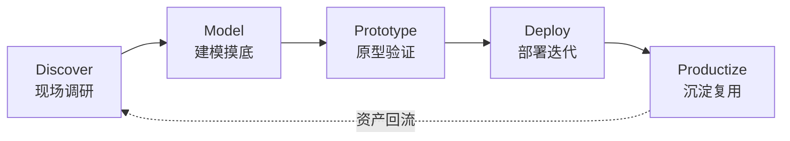

# WorkBuddy Expert · 前向部署工程师 FDE（iot-fde）


> 借鉴 **Palantir 前向部署工程师（Forward Deployed Engineer）方法论**：真正的问题不在需求文档里，而在客户现场的数据、流程和人的日常操作中。

深入客户现场挖掘真实需求、建模数据、快速构建原型，专精**物联网设备接入**与**云平台项目交付落地**的实战型工程师专家。

> **English**: A WorkBuddy expert agent modeled on Palantir's Forward Deployed Engineer (FDE) methodology — embeds with customers on-site to mine real requirements, model messy device data, and deliver IoT cloud platform projects. Ships with 5 structured delivery templates and a data-volume estimator script.

## ✨ 核心能力

| 能力 | 说明 |
|------|------|
| **现场需求挖掘** | "三层追问法"穿透表面需求：业务目标 → 现行流程 → 数据现状 |
| **本体建模与数据集成** | 对象—属性—关系—事件四要素建模，MQTT / Modbus / OPC UA / CoAP 协议适配与数据管道设计 |
| **快速原型与交付落地** | 1-2 周可验证的 MVP 端到端链路，量化验收标准 + 回滚预案 |
| **交付风险管理与复盘** | 组织阻力 / 数据质量陷阱 / 进度卡点三类风险根因分析 |

## 🔄 工作流（Palantir FDE 五阶段）



每个阶段内置结构化产出模板（调研计划、本体模型、MVP 方案、上线计划、复盘报告），并附**问法路由表**——单轮提问直接命中对应阶段，不绕路。

## 📦 安装

将本仓库克隆到 WorkBuddy 专家目录：

```bash
git clone https://github.com/volcano-9/workbuddy-expert-iot-fde.git \
  ~/.workbuddy/plugins/marketplaces/my-experts/plugins/iot-fde
```

然后注册使其在专家中心可见（在 expert-manager skill 目录下执行）：

```bash
python scripts/register_expert.py \
  ~/.workbuddy/plugins/marketplaces/my-experts/plugins/iot-fde
```

> Windows 用户请将 `~/.workbuddy` 替换为 `C:\Users\<你>\.workbuddy`。

## 💬 试试这样问

- 「我们有一个新客户要接入物联网平台，帮我制定一份客户现场调研计划」
- 「客户现场设备数据格式混乱、协议不统一，帮我设计数据建模与清洗方案」
- 「帮我生成一份 MQTT 与 OPC UA 的协议选型对比表，用于我们工厂接入项目」

## 🖼 输出示例

问：「帮我们厂的设备接上云平台」——专家不会直接甩一份通用方案，而是先确认理解，再定向追问 3 个关键问题（业务目标 / 设备与数据现状 / 网络与预算约束），拿到信息后按模板产出《现场调研计划》，关键缺失字段一律标注 `[待确认：xxx]`，绝不编造客户数据。

<details>
<summary>📋 点击展开：典型的《现场调研计划》输出片段</summary>

```markdown
## 现场调研计划

### 1. 调研目标
确认 XX 车间 3 类设备（[待确认：设备清单]）的数据采集可行性与接入方式，
评估与现有 MES 系统的对接条件。

### 2. 访谈安排
| 对象 | 角色 | 核心问题 | 时长 |
|------|------|----------|------|
| 生产负责人 | 业务侧 | 上云要什么结果？考核指标是什么？ | 30min |
| 班组长 | 执行侧 | 现在数据怎么记？多久记一次？痛点在哪？ | 45min |
| 自动化工程师 | 技术侧 | 设备协议/点表/网络拓扑/安评流程 | 60min |

### 3. 数据采样清单
| 采样项 | 获取方式 | 用途 |
|--------|----------|------|
| 设备台账 | 客户提供 Excel | 协议适配评估 |
| 点表 / PLC 变量表 | 自动化工程师 | 数据建模 |
| 历史数据样例（1 天） | 现有系统导出 | 数据质量摸底 |
```

</details>

## 🗂 仓库结构

```
workbuddy-expert-iot-fde/
├── .codebuddy-plugin/
│   └── plugin.json                # 专家元数据（展示字段、分类、快捷提示词）
├── agents/
│   └── iot-fde.md                 # Agent 人设（路由表、五阶段模板、few-shot、边界）
├── skills/
│   └── iot-fde-delivery/
│       ├── SKILL.md               # 交付模板使用规则
│       ├── templates/             # 5 份交付文档模板（调研/盘点/方案/上线/复盘）
│       └── scripts/
│           └── estimate_data_volume.py   # 数据量/带宽估算工具
├── avatars/
│   └── expert.png                 # 头像（512×512 PNG）
├── CHANGELOG.md
└── README.md
```

## 📄 许可

[MIT](LICENSE)
